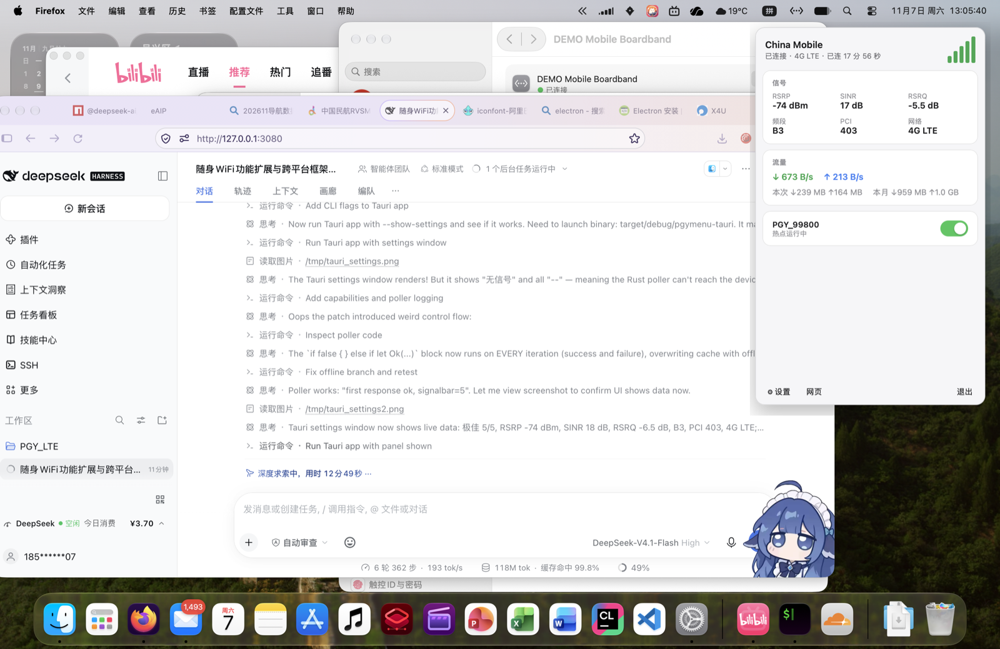
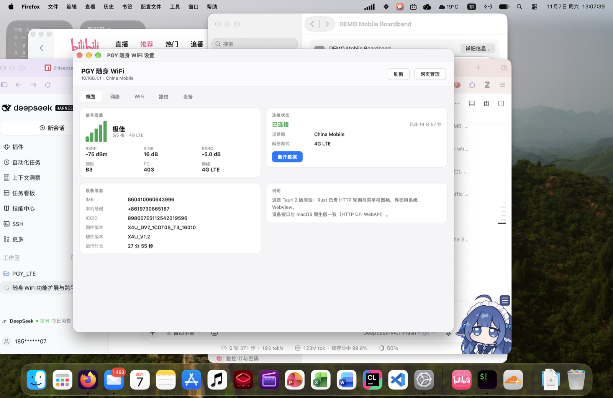

# PGY Menu

给 **PGY / X4U 系列随身 WiFi**（Unisoc 方案，管理页 `http://10.168.1.1`）做的桌面客户端。
菜单栏 / 通知区域实时显示信号，点开就能看流量、开关 WiFi，设置窗口里管理网络、SIM、路由等。

[](https://github.com/Enderman112/pgy-menu/actions/workflows/ci.yml)
[](LICENSE)

| 菜单栏面板 | 设置窗口 |
|---|---|
|  |  |

## 功能

- **托盘实时信号**：五格信号柱随 `signalbar` 变化，深浅色自动适配；未连接时变暗
- **快捷面板**：运营商、制式、已连时长、RSRP / SINR / RSRQ、频段 / PCI / CellID、实时上下行速度、本次 / 本月流量、WiFi 开关
- **右键菜单**：打开面板 / 设置 / 网页管理 / 退出
- **设置窗口**
  - 概览：信号、连接状态、设备信息（IMEI / 号码 / ICCID / 固件）
  - 网络：SIM 切换（内置 eSIM / 外置实体卡）、拨号连接 / 断开、网络模式、APN 列表与切换
  - WiFi：热点开关、SSID、密码、隐藏 SSID
  - 路由：LAN IP / 掩码 / DHCP 地址池 / 租期、UPnP、DMZ
  - 设备：管理密码（钥匙串保存）、修改设备密码、开机自启、重启、打开网页管理、退出
- **2 秒轮询**，Rust 后端直连设备 HTTP API（前端不碰网络，无 CORS 问题）
- **macOS 菜单栏 / Windows 通知区域** 原生托盘体验
- 管理密码存入系统钥匙串（macOS Keychain / Windows 凭据管理器），开机自启用 Tauri autostart 插件

## 技术栈与目录

- **Rust + Tauri 2**：后端负责 HTTP、轮询、托盘图标、窗口控制
- **原生 HTML/CSS/JS**：`window.__TAURI__` 调用命令，渲染面板和设置窗口
- 不依赖 React/Vue，也没有构建步骤（静态资源直接打包）

```
.
├── apps/
│   ├── desktop/            # Tauri 2 应用（主实现）
│   │   ├── src/            # 前端：panel.html / settings.html / style.css / *.js
│   │   ├── src-tauri/      # Rust：设备 API、轮询、托盘、窗口
│   │   ├── package.json
│   │   └── icon-source.png # 应用图标源文件（npx tauri icon 生成 icons/）
│   └── macos-swift/        # 早期 macOS 原生实现（SwiftUI，保留参考）
├── docs/
│   ├── DEVICE_API.md       # 逆向出的设备 WebAPI 文档
│   └── screenshots/
└── .github/workflows/      # CI + Release
```

## 快速开始

前置：**Rust stable**、**Node.js 20+**；macOS 需要 Xcode Command Line Tools，Windows 需要 WebView2（Win10/11 自带）和 MSVC 生成工具。

```bash
cd apps/desktop
npm install
npm run dev        # 开发模式（热加载前端）
npm run build      # 打包安装包（macOS: dmg/app；Windows: msi/nsis）
# 只编译、不打安装包：
npx tauri build --no-bundle
```

调试用参数：`npm run dev -- -- --show-settings`（直接打开设置窗口）或 `-- --show-panel`。

## 设备 API

设备网页是一套 ZTE UFI WebAPI（HTTP/1.0，无 Cookie，登录态按客户端 IP）。

- 读：`GET /goform/goform_get_cmd_process?isTest=false&multi_data=1&cmd=a,b,c`
- 写：`POST /goform/goform_set_cmd_process`（`isTest=false&goformId=...`）
- 登录：`goformId=LOGIN&username=<b64>&password=<b64>`，默认 `admin/admin`
- 信号：`signalbar` 0~5；RSRP 直接 dBm；RSRQ = `(nv_rsrq - 40) / 2`；SINR = `nv_sinr`

完整字段与命令见 [`docs/DEVICE_API.md`](docs/DEVICE_API.md)。

## CI / 发布

- **CI**（`.github/workflows/ci.yml`）：push / PR 时在 macOS + Windows 上做
  `rustfmt --check`、`clippy -D warnings`、`tauri build --no-bundle`，并编译 macOS 原生版
- **Release**（`.github/workflows/release.yml`）：推送 `v*` tag 自动构建并上传
  macOS `.dmg/.app`、Windows `.msi/.nsis` 到 GitHub Release（草稿）

```bash
git tag v1.0.0 && git push origin v1.0.0
```

## 已知限制

- 发布包**未签名**：macOS 首次打开需右键 →「打开」；Windows 可能弹 SmartScreen
- **短信**：本机固件未启用短信模块（`sms_capacity_info` 全 0），故未实现
- 默认管理密码为 `admin`，可在「设置 → 设备」里修改并保存到系统钥匙串
- 频段锁定只读展示；设备固件有接口但锁错频段会无服务
- 托盘面板定位：macOS 贴菜单栏图标，Windows 固定在任务栏上方右下角

## License

[MIT](LICENSE)

---

[](https://github.com/deepseek-ai/deepseek-harness)
